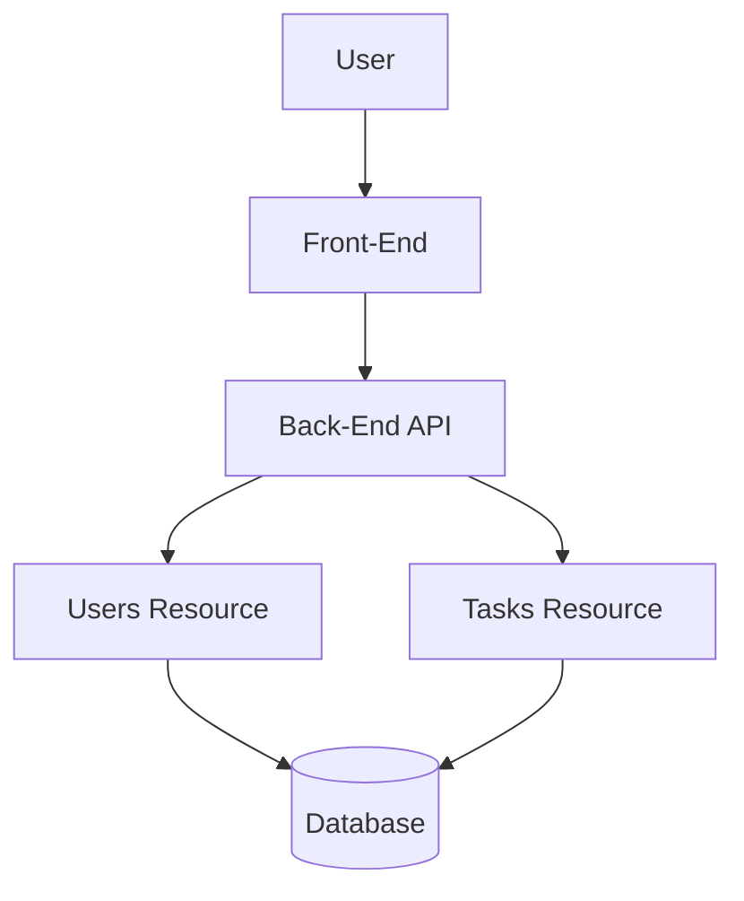

# College Management System
## API Contract

This document describes the initial API design for the College Management System.

### 1. Users Resource

| Method | Endpoint | Description | Status Code |
|---|---|---|---|
| GET | /api/users | Get all users | 200 OK |
| GET | /api/users/{id} | Get a user by ID | 200 OK |
| POST | /api/users | Create a new user | 201 Created |
| PUT | /api/users/{id} | Update a user | 200 OK |
| DELETE | /api/users/{id} | Delete a user | 204 No Content |

### 2. Tasks Resource

| Method | Endpoint | Description | Status Code |
|---|---|---|---|
| GET | /api/tasks | Get all tasks | 200 OK |
| GET | /api/tasks/{id} | Get a task by ID | 200 OK |
| POST | /api/tasks | Create a new task | 201 Created |
| PUT | /api/tasks/{id} | Update a task | 200 OK |
| DELETE | /api/tasks/{id} | Delete a task | 204 No Content |

### 3. Architecture Diagram

### 4. Error Status Codes

- 400 Bad Request: Invalid request.
- 401 Unauthorized: Authentication required.
- 404 Not Found: Resource not found.
- 500 Internal Server Error: Server error.

### 5. Conclusion

This API Contract defines the initial endpoints and communication structure of the College Management System.
